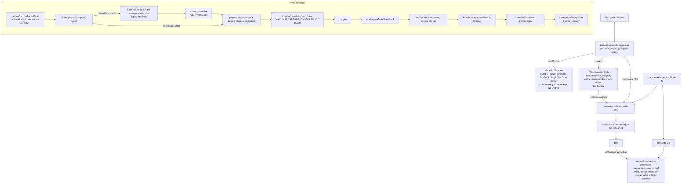

# Manual CI performance

## Baseline

Measured on 2026-10-28 from the GitHub Actions history of
`carbogninalberto/assozeta` (read-only `gh run list/view` and the jobs/logs
API). All runs use `ubuntu-24.04` GitHub-hosted runners. Wall time runs from the
attempt's `run_started_at` to `updated_at`. Phase times inside a step come from
the timestamps of the runner's own progress lines in the job log. No numbers
here are estimates.

`manuale-verify.yml` is a reusable workflow, so it never shows up as a run of
its own. Its two jobs appear inside `manuale.yml` ("Verify manual workflows and
MCP knowledge") and `manuale-release.yml` ("Build and rehearse the release
manual"). The jobs run one after the other: `verify` (select, verify and
package) first, then `appliance` (package startup checks, or the historical
rehearsal when the mode is full).

### Run totals

Fully cached runs (`Mode: reuse`, 0 fresh / 60 reused workflows, 42 retained render pages):

| Run | Workflow / event | Date | Head | Wall | verify job | appliance job |
| --- | --- | --- | --- | --- | --- | --- |
| 40444819255 | manuale.yml / push main | 2026-10-27 | 136a26b4 | 28.1 min | 19.1 min | 8.9 min |
| 40667149133 | manuale.yml / push main | 2026-10-28 | 58d8af88 | 25.6 min | 18.2 min | 7.2 min |
| 40689858334 (attempt 2) | manuale.yml / push main | 2026-10-28 | c2f4006b | 26.5 min | 18.6 min | 7.8 min |
| 40444843488 | manuale-release.yml / dispatch | 2026-10-27 | 136a26b4 | 27.5 min | 20.9 min | 6.5 min |

So the claim of about 28 minutes for a fully cached verification holds: these
runs took 25.6 to 28.1 minutes with nothing to capture or render.

Full runs (`Mode: full`, 60 fresh workflows, 42 fresh render pages, historical appliance rehearsal):

| Run | Workflow / event | Date | Head | Wall | verify job | appliance job |
| --- | --- | --- | --- | --- | --- | --- |
| 40688878441 | manuale.yml / PR chore/vendor-manual | 2026-10-28 | 699c0aa8 | 71.6 min | 50.8 min | 20.7 min |
| 40609557271 | manuale.yml / PR | 2026-10-28 | 4b744397 | 69.7 min | 49.1 min | 20.5 min |
| 40570118972 | manuale.yml / PR | 2026-10-27 | a1c514db | 85.4 min | 65.8 min | 19.4 min |
| 40486911604 | manuale.yml / PR | 2026-10-27 | 70eb1410 | 76.0 min | 56.8 min | 19.1 min |
| 40471688683 | manuale.yml / PR | 2026-10-27 | 61f2eaac | 75.7 min | 56.1 min | 19.5 min |
| 40428481241 | manuale-release.yml / dispatch | 2026-10-27 | 347d61cf | 73.5 min | 56.9 min | 16.5 min |

`pull-request-quality.yml` has no manual-specific job. For the same vendoring
PR it took 0.8 min (run 40688878438), while `manuale.yml` took 71.6 min. In
other PR quality runs the longest job was the backend test job, at 14.2 to
21.5 min (runs 40609557251, 40570118973 and 40437337729). That job is
unrelated to the manual.

### Per-step breakdown: fully cached run 40444819255

`verify` job (19.1 min):

| Step | Seconds | What runs |
| --- | ---: | --- |
| checkout, setup-node, setup-python, pin, prepare-storage | 37 | prepare-storage runs `storage-smoke.sh` |
| Install verifier dependencies | 29 | pip, `npm ci`, `playwright install --with-deps chromium` |
| Check verifier and runtime contracts | 75 | `manuale.py doctor` (Chromium probe), Python and Node unit tests |
| Admit a successful trusted baseline | 52 | downloads the `manuale-verified-baseline` artifact (about 619 MB) |
| Explain fresh, reused and unaffected work | 99 | `prepare`: worktrees and authored-procedure validation (98 s of it) |
| Capture only workflows requiring fresh evidence | 15 | nothing selected, no services started |
| Compile complete content and verify source evidence | 30 | MDX compile and source catalog, no services |
| Verify changed pages and retain compatible render evidence | 16 | 0 fresh pages, so Mintlify is not started |
| Check current reader, access control, MCP and assistant | 594 | see the runtime breakdown below |
| Bind package to the exact application revision and release | 56 | `manuale-release.py --bundle` |
| Remove only this run's fixture services | 5 | `docker compose down --volumes` |
| Seal verified reusable baseline | 71 | builds `manuale-baseline.tar.gz` |
| Upload baseline / runtime / verification artifacts | 22 + 4 + 35 | about 619 MB + 48 MB + 666 MB |

The runtime step is a fixed cost even when nothing changed. It always starts the
full Docker Compose stack:

| Phase (log line) | 40444819255 | 40667149133 | 40689858334 |
| --- | ---: | ---: | ---: |
| Build the retrieval corpus on the host | 19 s | 12 s | 21 s |
| Build run-specific application images (`api`, `ui`, `renderer`) | 120 s | 104 s | 111 s |
| Start run-owned dependencies (Postgres, Redis, MinIO, PDF renderer) | 12 s | 11 s | 10 s |
| Migrate isolated database | 54 s | 38 s | 57 s |
| Seed the fictional association and browser session | 23 s | 20 s | 22 s |
| MCP and agent evaluation (`evaluate_manuale`) | 85 s | 47 s | 87 s |
| In-app reader in Chromium (`embedded.mjs`) | 280 s | 515 s | 279 s |
| Step total | 594 s | 747 s | 587 s |

`appliance` job (8.9 min, `manual-release-smoke.py --scope compatibility`,
469.7 s elapsed): production images built and historical digests resolved
291.2 s, fresh installation with reader, assets, search and the browser
assistant 120.5 s, container recreation 54.5 s. The job also installs
Chromium again (30 s) and downloads the 48 MB runtime package (5 s).

### Per-step breakdown: full runs

| Step | 40688878441 | 40609557271 | 40570118972 | 40486911604 | 40471688683 | 40428481241 |
| --- | ---: | ---: | ---: | ---: | ---: | ---: |
| Install verifier dependencies | 25 s | below 60 s | 322 s | below 60 s | below 60 s | 463 s |
| Admit trusted baseline (download) | 56 s | 67 s | 202 s | 68 s | 111 s | below 60 s |
| Capture (Docker stack and 60 workflows in Chromium) | 2076 s | 1945 s | 2593 s | 2528 s | 2438 s | 2015 s |
| Render (Mintlify) | 183 s | 161 s | 235 s | 236 s | 230 s | 165 s |
| Runtime (reader, MCP, assistant) | 503 s | 591 s | 350 s | 329 s | 330 s | 577 s |
| Historical appliance rehearsal | 1154 s | 1178 s | 1105 s | 1087 s | 1120 s | 925 s |

The "below 60 s" cells come from a listing that only printed steps longer than
60 s. Install times of 322 s and 463 s were slow apt and Playwright downloads.

Capture phase of run 40609557271: image build 100 s, dependency start 11 s,
migration 35 s, then seeding and the 60 workflow captures (00:39:06 to
01:09:06, about 30 minutes). The runtime phase of the same run spent 542 s in
`embedded.mjs`.

Historical rehearsal of run 40688878441 (1152.9 s): production images and
historical digests 467.2 s, fresh install 131.3 s, recreation 57.6 s,
interrupted-start recovery 46.3 s, failed-download recovery 36.2 s,
corrupt-candidate rejection 17.6 s + 40.0 s + 186.9 s, 1.0.17 upgrade 78.4 s,
backup rollback 87.1 s.

### Mintlify cost (render phase with fresh pages)

`docs/scripts/manuale.py verify` started `npx --yes mint@4.2.955 dev` on a
copy of the manual and then drove it with `verify.mjs` in Chromium. Mintlify is
not installed by any workflow step: `npx` downloads it while the render step
runs.

| Run | `mint` download and start (until ready) | `verify.mjs`, 42 pages | Render step |
| --- | ---: | ---: | ---: |
| 40688878441 | 7.9 s | 174.1 s | 183 s |
| 40609557271 | 6.5 s | 154.7 s | 161 s |
| 40570118972 | 9.4 s | 224.4 s | 235 s |
| 40486911604 | 9.7 s | 225.3 s | 236 s |
| 40471688683 | 9.5 s | 219.0 s | 230 s |
| 40428481241 | 6.5 s | 157.4 s | 165 s |

With 0 fresh pages (reuse mode) the render step took 10 to 16 s and did not
start Mintlify.

### Evidence artifacts

| Artifact | Size | Transfer |
| --- | --- | --- |
| `manuale-verified-baseline` (downloaded by "Admit", uploaded after sealing) | 515 to 720 MB | download inside "Admit" (25 to 202 s); upload 18 to 22 s |
| `manuale-verification` (decisions, renders, export) | 546 to 666 MB | upload 21 to 35 s |
| `manuale-release-runtime` | 45.5 to 47.5 MB | download 1 to 5 s in the appliance job |
| `manuale-release-evidence` | 2.0 to 4.6 MB | upload about 1 s |

### Bottlenecks identified

1. The runtime phase always starts Docker Compose: an image build (104 to
   120 s), Postgres, Redis, MinIO and the PDF renderer (10 to 12 s), migrations
   (38 to 57 s) and seeding (20 to 23 s). It then runs `embedded.mjs` in
   Chromium (279 to 515 s), even when every workflow and page is reused. In the
   cached runs this phase alone is 587 to 747 s.
2. The appliance job always builds production images (291 s compatibility,
   467 s full) and boots the appliance. With the job's own setup this adds 6.5
   to 8.9 minutes to every cached run.
3. Fresh captures take 1945 to 2593 s in full mode. Each one goes through a
   Docker Compose start (image build, dependencies, migration, seed) followed
   by 60 workflows in Chromium.
4. Mintlify renders take 155 to 225 s per full run (42 pages in Chromium plus
   a 6.5 to 9.7 s `npx mint` download and start).
5. The fixed overhead of a cached `verify` job is about 7 minutes outside the
   runtime phase: the baseline download (about 619 MB, 25 to 202 s), `prepare`
   (59 to 103 s), unit tests in CI (50 to 77 s), sealing (44 to 79 s) and
   artifact uploads (about 1.3 GB in total).
6. Chromium is installed twice, once per job, inside each job's dependency
   install step (`playwright install --with-deps chromium`). That step usually
   takes 20 to 49 s, with outliers of 322 s and 463 s. Chromium is
   launched by the doctor probe, by the captures, by Mintlify `verify.mjs`, by
   `embedded.mjs` and by the appliance smoke.

The local unit suite (`python3 -m unittest discover -s docs/scripts/tests -p
'test_manuale*.py'`, 207 tests before this change) took 126.5 s on a developer
laptop on 2026-10-28.

## Redesign

### Architecture

### Modes

- **A, fast incremental** (`offline` and `content` jobs): provably unaffected
  changes and manual text-only changes. No Docker, Postgres, Redis, MinIO or
  application images. Text-only changes recompile and re-index from admitted
  evidence and run the offline in-app reader render check (`--phase render`,
  `BE/application/manuale/reader_render.py`). If any workflow would need a
  capture, `content` escalates to `verify`.
- **B, incremental behavioral** (`verify` with `comprehensive: false`): only
  the workflows the impact report marks affected, plus every workflow neither
  the store nor the trusted baseline can cover, are captured, in bounded
  parallel shards. Reused evidence is merged with explicit per-workflow
  provenance. Reader, MCP, assistant, access-control and package checks run on
  the complete result.
- **C, comprehensive release** (`manuale-release.yml`): no impact narrowing,
  contracts, full historical appliance rehearsal and the explicit
  `authorize` job. A Mode A or B result never authorizes publication; the gate
  rejects any non-comprehensive run.

`unknown`, `security` and `shared-contract` files fail closed to full
verification. Schedules and `force_full` also run full verification.

### Evidence identity and release identity

- **Evidence identity** is the per-workflow fingerprint
  (`manuale_evidence_store.workflow_fingerprint`): the impact module's
  `workflow_dependencies`, the literal import closure of the capture tooling,
  shared capture tooling (including `manuale_capture_shards.py`), fixtures and
  fixture version, browser environment, reference date, page mapping and the
  evidence schema version. An entry is reusable across commits while the
  fingerprint is identical.
- **Trust** comes only from the GitHub API: the producer run must be a
  successful push, release, schedule or dispatch of an approved workflow on the
  default branch or a release tag in this repository. PR artifacts are never a
  trusted baseline (neither the store nor the whole-run baseline), and PR runs
  never publish the store or upload a whole-run baseline. Download digests must
  match the artifact digest the API reports.
- **Admission** (`admit_selection`, used by `manuale.py --reuse-store`)
  re-verifies selection, manifest, evidence record, report and screenshot
  hashes, recomputes the fingerprint from the target checkout, and runs the same
  report and editorial gates as a whole-run baseline. It produces ordinary
  `evidence-reuse.json` entries marked `source: evidence-store` that keep the
  original application revision, capture id and producer. The retained-plan
  gate (also run by the corpus index and export) re-checks the embedded store
  manifest chain. ManualIndex, bundle and release checks are unchanged.
- **Release identity** is application commit + manual revision + version.
  `store-bind` writes `release-binding.json` for every workflow (fresh,
  store-reused, baseline-reused). The binding is rebuilt for every release and
  is rejected for any other identity: `store-verify-binding` checks it in every
  verify run, and the Mode C gate requires that verification.

### Expected behavior per scenario

Impact CLI results (`manuale-ci.py plan --base HEAD --changed-file PATH`,
working-tree edits in a scratch worktree of this branch, re-run after the
narrowing and classification fixes). "Mode" is the CI decision; "workflows" is
the affected count out of 60. "New function" appends an unreferenced function;
"body of" inserts a statement into an existing symbol. Measured wall times
are in "After".

| Change | Category | Mode | Workflows | Jobs started |
| --- | --- | --- | ---: | --- |
| New `BE_GO/cmd/probe.go` (unrelated tree) | unrelated | unaffected | 0 | plan, offline (no Bot/MCP suites) |
| One paragraph of `manuale/docs/comunicazioni.mdx` | docs-text | content | 0 | plan, offline (Bot + MCP suites), content |
| `UI/src/routes/profile/sections/TwoFactor.svelte` (recipe UI) | behavior | behavioral | 4 | plan, offline, verify (4 fresh captures), appliance (compatibility) |
| `selfhost/tests/browser/manuale/scenario.mjs` (shared capture tool) | capture-tooling | behavioral | 60 | plan, offline, verify (all captures), appliance (compatibility) |
| New function in `BE/core/authentication.py` (auth) | security | full | 60 | plan, offline, verify forced full, full appliance rehearsal |
| New function in `BE/application/agent/prompts.py` (Bot) | bot | unaffected | 0 | plan, offline with the Bot suites |
| New function in `BE/application/manuale/answers.py` (Bot, unreferenced symbol) | bot | unaffected | 0 | plan, offline with the Bot suites |
| Body of `_reader_strings` in `BE/application/manuale/answers.py` | behavior | behavioral | 60 | verify (all captures), Bot + MCP suites |
| New function in `BE/application/mcp_server/schema.py` (MCP) | mcp | unaffected | 0 | plan, offline with the MCP suites |
| New function in `BE/application/agent/core.py` (tenant/identity injection) | security | full | 60 | as for auth |
| New function in `BE/application/mcp_server/server.py` (MCP tool dispatch) | security | full | 60 | as for auth |
| New function in `BE/application/mcp_server/security.py` (MCP auth) | security | full | 60 | as for auth |
| Body of `RestoreMaintenanceMiddleware` in `BE/instance/restore/locking.py` (named in `MIDDLEWARE`) | security | full | 60 | as for auth |
| Body of `InstanceStatusView` in `BE/instance/views.py` (routed, outside every slice) | behavior | behavioral | 60 | verify (all captures) |
| `BE/application/tests/test_manuale_reader.py` (manual backend test) | mcp | unaffected | 0 | plan, offline with the Bot + MCP suites |
| `.github/workflows/publish-images.yml` | shared-contract | full | 60 | as for auth |
| New function in `BE/communications/views.py` | behavior | behavioral | 3 | verify with the 3 communication workflows |

Changes from the previous table: `agent/core.py` and `mcp_server/server.py`
moved from Bot-only/MCP-only to `security` (they inject or strip the tenant and
user identity of every tool call), so the Bot-only and MCP-only rows now use
`agent/prompts.py` and `mcp_server/schema.py`. Edits to existing symbols that
runtime code reaches outside every workflow slice (`_reader_strings`,
`InstanceStatusView`) were `unrelated`/unaffected before and now select every
workflow that uses the file (all 60 here, because the global closure reaches
these modules).

`BE/communications/views.py` is already covered: the
`communication-message-compose`, `communication-welcome-state` and
`communication-workflow-manage` recipes declare it, and a changed function used
only by the staff board selects all 60 workflows through the dashboard recipes.
No extra mapping was needed. The impact CLI took 2.0 to 4.1 s per call on a
developer laptop (local measurement, not GitHub Actions).

### Limitations and trade-offs

- Symbol narrowing only removes work it can prove. A changed top-level
  symbol outside every workflow slice is narrowed away only when no runtime
  entry point (URL tables and settings followed) reaches it; otherwise the
  whole file is classified, which for modules in the global closure means all
  60 workflows. Bot/MCP files keep their contract checks even when no capture
  is affected. Modules named by dotted strings in settings and URL tables are
  global dependencies (and part of every fingerprint); modules named under
  `python.security_settings` (MIDDLEWARE, authentication, permission, session,
  CSRF, token, throttle and similar settings) are `security`.
- Bot/MCP code that injects, strips or filters tenant and user identity
  (`agent/core.py`, `mcp_server/server.py`, `query_builder.py`,
  `attendance.py`, `exporters/__init__.py`, `chat/consumers.py`,
  `chat/views.py`, `manuale/tools.py`, `manuale/views.py`, `manuale/index.py`
  and the `run_agent`/`run_mcp_server` commands) is `security`, so edits there
  run full verification. Bot-only and MCP-only fast paths remain for prompts,
  routing, providers, callbacks, `answers.py`, schema and the exporters.
- Backend tests of the manual, Bot and MCP areas run the offline Bot and MCP
  suites. The installed-release manual contracts (`TESTS/contracts/test_manual.py`,
  `TESTS/browser/manual-release.mjs`, `TESTS/mcp/manual.py`) and
  `publish-images.yml` run full verification.
- Only push, release, dispatch or schedule runs of an approved workflow on the
  default branch or a release tag (same repository, commit on the default
  branch) are admitted as a whole-run baseline. Merged pull request runs no
  longer qualify, and pull request runs do not upload `manuale-verified-baseline`,
  so a merged change seeds the baseline only after its first trusted run.
- `--reuse-store` admits nothing unless the selection directory holds the
  `trusted-producers.json` record (the `store-producers` shape) that
  `store-materialize` wrote and bound by sha256 into the selection, and every
  manifest producer equals an authenticated record. There is no local opt-out:
  a developer reuses store evidence by materializing it with a
  `store-producers` record, never from a hand-made selection.
- Every verify run checks `release-binding.json` with `store-verify-binding`
  against the commit, pinned manual revision and version, and against the
  binding recomputed from the run's evidence. The gate blocks Mode C unless the
  verify job reports a verified binding for exactly this release and commit.
- Store publication cannot block image publication: `publish-images.yml`
  calls `manuale-release.yml` with `evidence_store: false` and runs the
  publisher as a separate job after `manual-release` succeeded, which no
  publication job depends on. An empty merged store uploads nothing instead of
  failing.
- The first trusted baseline and evidence store for this verifier were sealed
  by main run 40800297328 (80 m 36 s), after the import learned to check
  Mintlify-era render-reuse plans for integrity only. Two defects then kept
  reuse from working and are fixed: a pull request's history-free vendored
  manual commit could not be diffed against the baseline's, so any manual
  change recaptured every workflow (PR #42); and the store gate required
  fingerprint coverage for production files the precise closure proves
  unreachable, so no store entry was ever admitted (PR #44). Every change to
  `docs/scripts/manuale*` still needs a new trusted main run before
  narrowing works again.
- Editorial bindings are per section. Each reviewed section binds its recipe
  module with the reviewed hashes of sources outside its own source contracts
  elided (`BE/application/manuale/recipe_binding.py`, mirrored by
  `docs/manuale/recipe-binding.mjs`; the registry lists each section's
  contract paths as `reference_sections`). Re-pinning a reviewed source after
  editing it therefore invalidates only the sections whose contracts read
  that source. Any other module edit, a section without registered contracts,
  or a module whose reviewed hashes are not all in one-entry-per-line maps
  (`attendance-carnet-recipes.mjs`, `organization-additional-reference-recipes.mjs`,
  `reference-recipes.mjs`) still binds the whole file. Before this change the
  measured UI re-pin added 6 workflows to the 4 the impact plan selected
  (`editorial-recipe-binding-changed`).
- The store fingerprint uses the precise impact closure. Production files that
  the older prefix-based reuse contract lists but the impact analysis proves
  unreachable are not part of the fingerprint, so a store entry can be reused
  when such a file changed. The whole-run baseline gate keeps its byte-for-byte
  prefix comparison. The tooling import closure and every file a capture
  recorded in `source_hashes` must still match exactly.
- Store reuse adds to an admitted trusted whole-run baseline; it does not
  replace it. When no baseline is admitted, `manuale-policy.verification_decision`
  still chooses full verification (infrastructure changes are detected against
  the baseline), and `prepare` drops the store reuse. Relaxing this would need
  a policy decision; it was left conservative.
- Wording-only MDX edits change no fingerprint (the fingerprint uses the page
  mapping, not prose), and the reviewed-wording gate still applies at
  admission. An entry without reviewed section bindings is captured fresh.
- Store trust is established at restore time with the GitHub API. The offline
  gates afterwards re-check integrity and structural producer rules only.
- The blobs artifact is close to the size of all screenshots. It is downloaded
  only when at least one workflow is reusable, and by the post-gate publisher.
  Publishing is skipped when every workflow reused trusted evidence, so a store
  with no fresh captures for 90 days expires and the next run is cold.
- MCP-only changes run the offline MCP suites, not the database-backed
  `test_mcp_stdio.py`. `mcp_server/security.py` is classified `security` and
  runs full verification.
- `MANUALE_BUILDX_CACHE=gha` is opt-in and was not exercised on GitHub Actions.
- Capture shards are off by default in CI (`MANUALE_CAPTURE_CONCURRENCY=1`).
  With `auto` (2 shards on a 4 vCPU / 16 GB hosted runner), full captures on
  this branch failed 8 or 9 different workflows per run, with a different set
  each time and mostly click timeouts or browser errors (runs 40770979959,
  40771977869, 40774163486, 40774816473). The shards ran as separate private
  stacks, so no state was shared, and the capture step still took about 32 min.
  The same 60 workflows had passed sequentially in 32 to 43 min on earlier
  full runs (40688878441, 40609557271, 40570118972). Sharding remains opt-in
  through `vars.MANUALE_CAPTURE_CONCURRENCY` for larger runners.
- `actionlint` 1.7.7 passed on the workflows. Embedded shell was not checked
  because `shellcheck` was not installed.

### Optimizations not implemented

- Skipping the runtime phase (Compose start, migrations, `embedded.mjs`) for
  Mode B: kept. Reader, access control and MCP must be checked on the complete
  corpus that the change produces.
- Skipping or caching the appliance image build in Mode B/C: kept. Package
  startup and the release checks are mandatory, and reusing images across
  revisions would break the exact-revision binding.
- Larger runners or more than 4 shards: not added. No new paid
  infrastructure, and the shard cap protects 16 GB hosted runners.
- Remote caching services or a database for evidence: not added. Artifacts
  and the GitHub API are the only trust and storage layers.
- Splitting `embedded.mjs` per page for partial reruns: not done. The real
  browser reader check stays whole-corpus.

## After

Measured on GitHub Actions (`ubuntu-24.04`), wall time from `run_started_at`
to `updated_at`, with the same method as "Baseline". Scenario runs are
throwaway draft pull requests. Unaffected runs need no baseline; the content
and behavioral runs reused the trusted main seal of their base (runs
40818930740 and 40840661015). "Before" is the fully cached range (25.6 to 28.1 min) and the full
range (69.7 to 85.4 min) measured above.

| Scenario | Mode | Wall time | verify job | Fresh / reused workflows | Run |
| --- | --- | --- | --- | --- | --- |
| Unrelated change (`BE_GO/`) | A, unaffected | 2 m 21 s | not started | none captured | 40771965650 |
| MCP-only change | A, unaffected + MCP suites | 3 m 29 s | not started | none captured | 40771985039 |
| Bot-only change | A, unaffected + Bot suites | 4 m 07 s | not started | none captured | 40771981402 |
| One MDX paragraph | A, content | 5 m 18 s | not started (content job 5 m 02 s) | 0 / 60, 1 page recompiled | 40827010923 |
| One documented UI workflow (with the reviewed-source re-pin) | B, behavioral | 41 m 41 s | 34 m 08 s | 10 / 50 (plan: 4) | 40850276909 |
| Same UI change before PR #44 | B, behavioral | 45 m 27 s | 38 m 00 s | 10 / 50, store unusable | 40827015598 |
| Manual tooling change (PR #42) | full | 69 m 40 s | 49 m 55 s + 19 m 09 s rehearsal | 60 / 0 | 40812303020 |
| First trusted main run after the redesign (cold store) | full + seal + publish | 80 m 36 s | 63 m 00 s | 60 / 0 | 40800297328 |
| Later main seals after tooling changes | full + seal + publish | 84 m 12 s, 75 m 39 s | 61 m 10 s, 57 m 15 s | 60 / 0 | 40818930740, 40840661015 |

Store costs in the behavioral run: index 1.9 s, plan 2 m 14 s, blobs 5.8 s,
materialize 2 m 09 s.

Against the fully cached baseline, unrelated, Bot-only and MCP-only changes
are 84 to 92% faster, and a text-only manual change is 79 to 81% faster (92
to 94% against a full run). The 95% target is not reached: the fastest
measured path, the unrelated change, is 91 to 92% faster than a cached run
and 97% faster than a full one. A one-workflow UI change is now 40 to 51% faster
than a full run but 48 to 63% slower than the old fully cached run, because
it captures fresh evidence (10 workflows, see the editorial-binding
limitation) and runs the package checks. Not measured: a shared capture tool
change (sharded Mode B) and a Mode C release run of `manuale-release.yml`.
